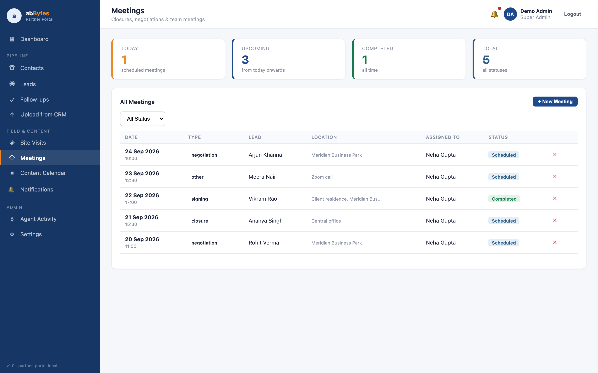
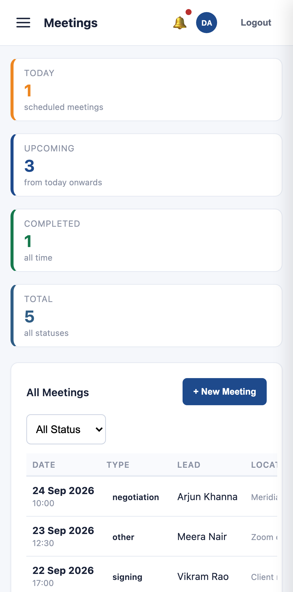

# Partner Portal (retired): a telecalling tool for one field agent

> **Status: RETIRED.** Built in May 2026 for **one** field agent at Rent A Roof. Its leads moved into the main Rent A Roof CRM in July 2026, and the portal was retired in September 2026. This page is a case study of a tool that is no longer in use.

**My role:** requirements, product decisions and testing. AI-assisted build: I directed AI coding tools and tested every change.

Rent A Roof is a South Delhi property-consultation company. While Rent A Roof was still on its old subscription CRM, and before its new CRM was built (Jun–Sep 2026), one field agent needed a simple place to work a calling list: upload contacts, call through them, qualify, book site visits, and keep the follow-ups honest. This portal was that stopgap.

**Results**
- 132 leads by 29 May 2026, the month it was built.
- 348 leads in the calling queue by 10 Jun 2026.
- Its leads moved into the main CRM in July 2026; the portal was retired in September 2026.

*The source is in a private repo; happy to walk a serious reviewer through it on request.*

---

## What it did

- **Contacts → leads**: upload a contact list from a spreadsheet and work it as a calling queue.
- **Telecalling**: log call attempts and outcomes (interested / callback / not picked / wrong number), notes and attempt counts, with a "stale after N days" flag.
- **Qualification & stages**: move leads New → Contacted → Qualified → Visit Scheduled → Visited → Closed / Lost, with disqualify and revive paths.
- **Site visits & meetings**: schedule site visits and meetings and track their status.
- **Content calendar**: a calendar for planning social-media content shoots.
- **Follow-ups**: everything due in one queue (overdue, today, upcoming).
- **WhatsApp reply templates**: pre-written messages for common replies, sent by hand from WhatsApp (no WhatsApp API or automation).
- **Monitor**: an admin-only view of the agent's calling activity (calls attempted and logged, daily sessions, monthly reports), with role-based access.

---

## Screenshots · *demo build*

Screenshots are from a demo build of the same app, seeded in Sep 2026 after the portal was retired: a placeholder brand ("abBytes"), fictional people and sample staff accounts. Dates, activity and assignees on screen are demo data, not production usage. Screens that list phone numbers (leads, follow-ups, monitor) are not shown.

**Meetings**: negotiations, signings and closures, with date, location, assignee and status

**Meetings on mobile**

---

## Tech
Laravel 13 · Blade · custom CSS · vanilla JavaScript · Chart.js · MariaDB (MySQL-compatible) · PHP 8.3+ · PhpSpreadsheet (contact uploads) · DomPDF (monthly reports) · custom auth · role-based access

---
Developed by **[@abBytes-sudo](https://github.com/abBytes-sudo)** for Rent A Roof · [LinkedIn](https://www.linkedin.com/in/abhishek-m-b934a925a)

© 2026 Abhishek Anand Masih. Write-up and screenshots shared for portfolio review; not licensed for reuse.
